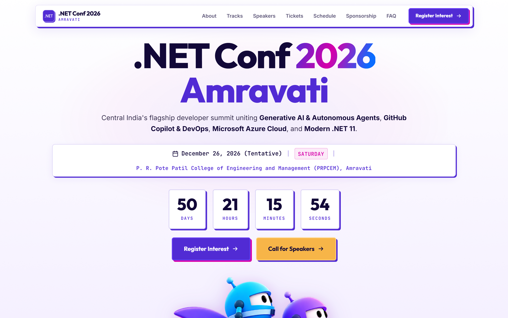
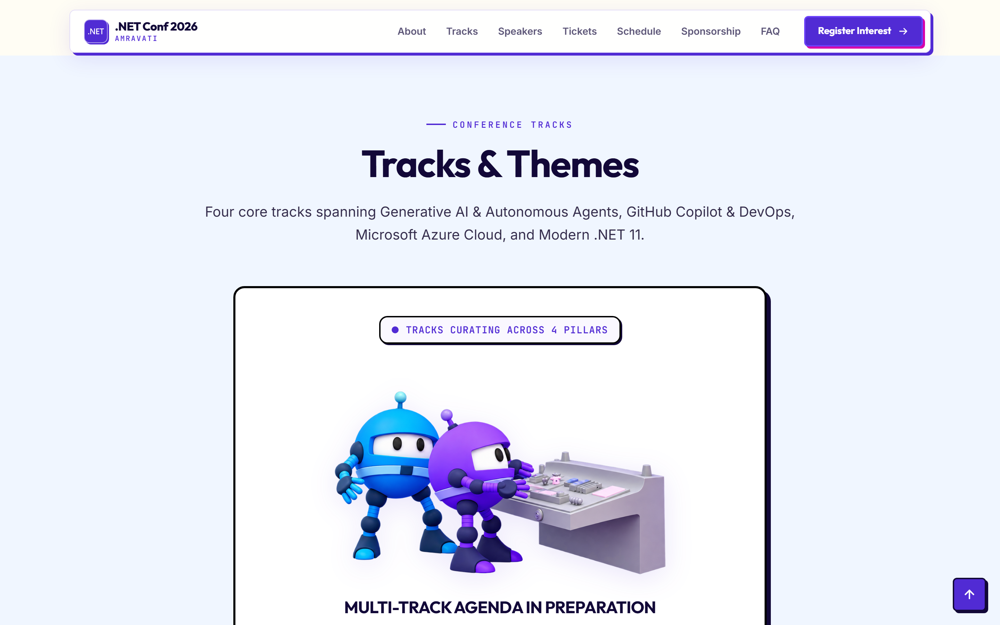
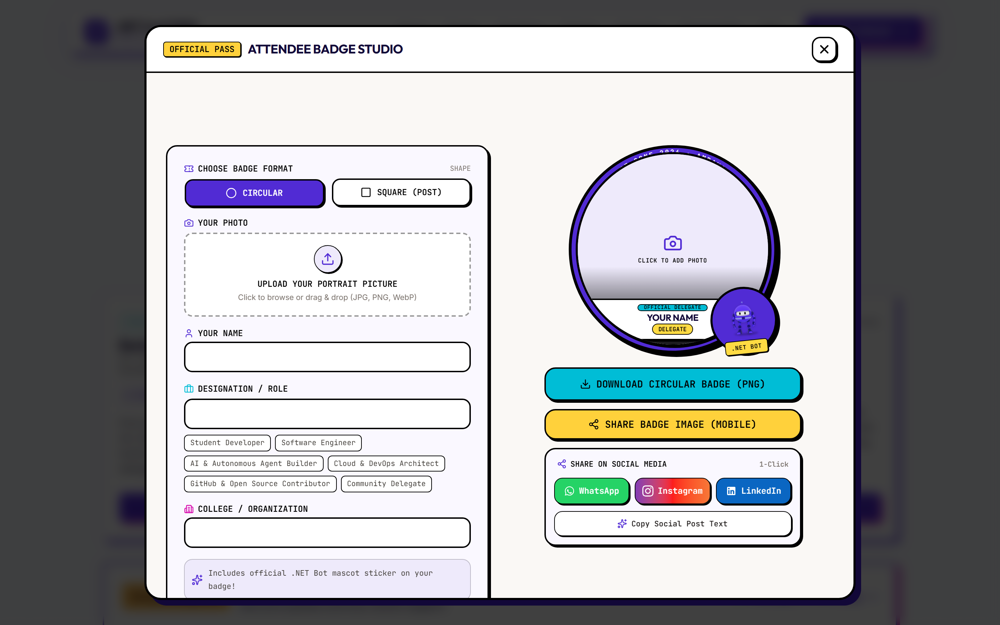
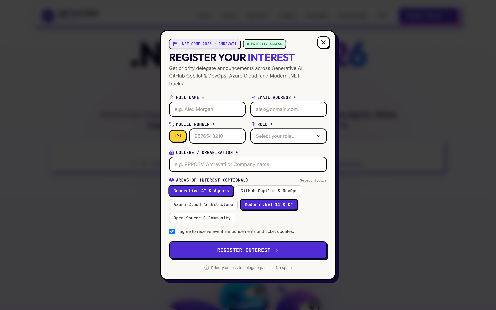
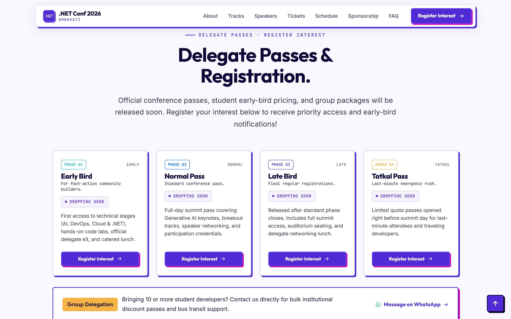
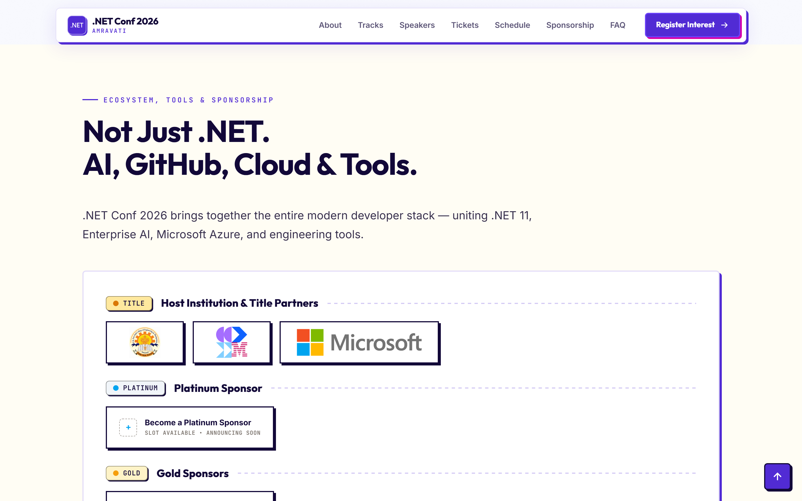
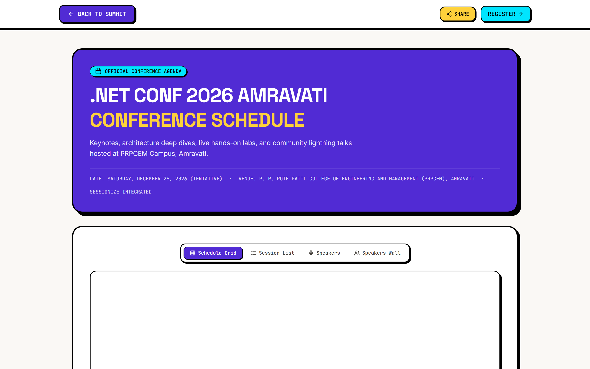
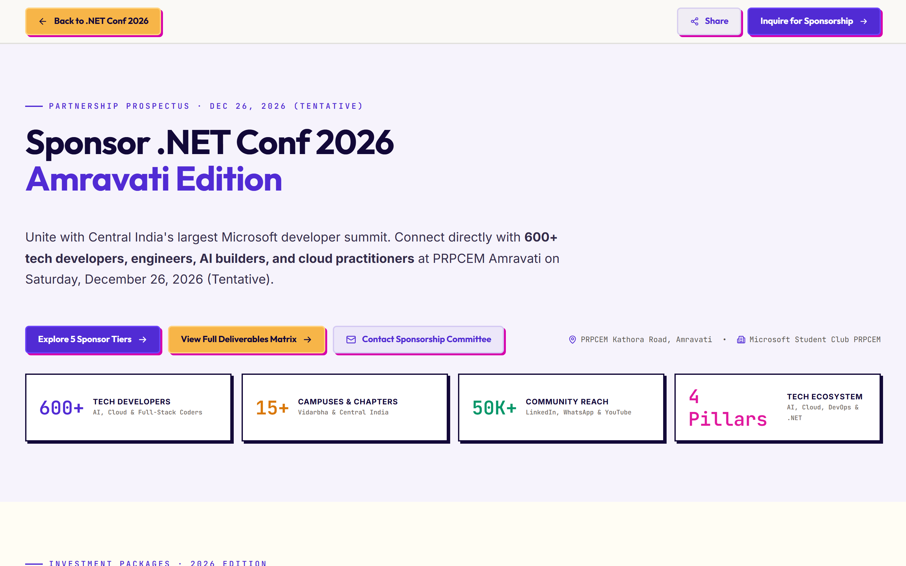

# .NET Conf 2026 — Amravati 🚀

[](https://react.dev/)
[](https://vite.dev/)
[](https://tailwindcss.com/)
[](https://sessionize.com/dnc26)
[](https://prpcem.ac.in)
[](LICENSE)

**Central India's Premier Microsoft Ecosystem & Developer Summit**  
Organized by **Microsoft Student Club (MSC)** at **P. R. Pote Patil College of Engineering and Management (PRPCEM)**

- 📅 **Date:** Saturday, December 26, 2026  
- 📍 **Venue:** P. R. Pote Patil College of Engineering and Management (PRPCEM), Pote Estate, Kathora Road, Amravati, Maharashtra 444602  
- 🌐 **Live Platform:** [dnc.mscprpcem.tech](https://dnc.mscprpcem.tech)

---

## 📸 Visual Showcase

### 🌟 Conference Landing & Neo-Brutalist Experience
The official summit portal features high-contrast neo-brutalist styling, Warli folk-tech vector motifs, interactive countdowns, and dynamic marquee streams.



---

## 📑 Table of Contents

- [About the Summit](#-about-the-summit)
- [Key Features](#-key-features)
- [Visual Highlights & UI Previews](#-visual-highlights--ui-previews)
  - [Core Tech Pillars & Tracks](#1-core-tech-pillars--tracks)
  - [Attendee Badge Studio](#2-attendee-badge-studio)
  - [Priority Delegate Registration](#3-priority-delegate-registration)
  - [Passes & Access Tiers](#4-passes--access-tiers)
  - [Sponsors & Community Partners](#5-sponsors--community-partners)
  - [Summit Schedule & Keynotes](#6-summit-schedule--keynotes)
  - [Sponsorship Brochure & Deck](#7-sponsorship-brochure--deck)
- [Tech Stack & Architecture](#-tech-stack--architecture)
- [Project Structure](#-project-structure)
- [Getting Started Locally](#-getting-started-locally)
- [Backend & Automation Integration](#-backend--automation-integration)
- [Design System & Palette](#-design-system--palette)
- [Community & Channels](#-community--channels)
- [Organization & Credits](#-organization--credits)
- [License](#-license)

---

## 🎯 About the Summit

**.NET Conf 2026 Amravati** unites software engineers, cloud architects, student innovators, and developer communities from Vidarbha and across India. 

Hosted at the sprawling campus of **P. R. Pote Patil College of Engineering and Management (PRPCEM), Amravati**, this full-day summit showcases cutting-edge advancements across the modern Microsoft ecosystem:

- 🧠 **Generative AI & Autonomous Agents** (Semantic Kernel, Azure OpenAI, RAG architecture, Local SLMs)
- 🤖 **GitHub Copilot & Modern DevOps** (GitHub Actions, Copilot Workspace, automated CI/CD pipelines)
- ☁️ **Microsoft Azure Cloud Architecture** (Azure Container Apps, Kubernetes, microservices resilience)
- ⚡ **Modern .NET 11 Runtime** (C# 14, Native AOT, ASP.NET Core performance engineering)

---

## ✨ Key Features

- **🎨 Neo-Brutalist + Warli Heritage Aesthetic:** Bold typography, crisp black offsets (`shadow-[6px_6px_0px_#000]`), and custom hand-crafted Maharashtra Warli vector art celebrating regional culture alongside modern code.
- **🎫 Interactive Attendee Badge Studio:** Generates customized, production-grade social share badges in real-time with photo crop/upload, name, role, ticket ID, and one-click download/sharing.
- **📝 Seamless Priority Registration Modal:** Full-featured form with client-side validation, track interest selection, and zero-page-jump scroll locking.
- **📧 Automated Themed Confirmation Mailer:** Integrates with Google Apps Script to dispatch responsive HTML confirmation emails with official MSC PRPCEM branding and delegate summary.
- **🔒 Isolated Modal & Overlay Scroll:** Enhanced UX preventing background page scrolling and eliminating scrollbar gutter artifacts on popups and mobile drawer navigation.
- **📢 Sessionize CFP Integration:** Direct integration for national and global speakers to submit session abstracts.
- **📱 Ultra-Responsive Design:** Tailored viewport layouts for mobile phones (360px+), tablets, laptops, and ultra-wide screens.

---

## 🖼️ Visual Highlights & UI Previews

### 1. Core Tech Pillars & Tracks
Interactive swimlanes highlighting the 4 foundational tracks with live syllabus tags, speaker counts, and deep-dive roadmaps.



### 2. Attendee Badge Studio
Attendees can create personalized digital badges with custom designations, QR codes, and instant sharing to LinkedIn, WhatsApp, and X.



### 3. Priority Delegate Registration
Streamlined delegate onboarding capturing technical track interests, contact details, and sending instant confirmation dispatch.



### 4. Passes & Access Tiers
Clear, transparent pass tiers (Student Delegate, Professional Pioneer, VIP & Speaker Pass) with detailed perk matrices.



### 5. Sponsors & Community Partners
Showcase of premier industry sponsors, in-kind partners, and institutional supporters backing the developer ecosystem.



### 6. Summit Schedule & Keynotes
Detailed timeline of keynotes, breakout tracks, live coding workshops, and networking luncheons.



### 7. Sponsorship Brochure & Deck
Dedicated portal and breakdown of sponsorship tiers, booth activations, brand reach, and deliverables.



---

## 🛠️ Tech Stack & Architecture

| Layer | Technology | Details |
| :--- | :--- | :--- |
| **Frontend Framework** | [React 19](https://react.dev/) | Functional components with modern hooks and clean state management |
| **Build & Tooling** | [Vite 8](https://vite.dev/) | Lightning-fast HMR, ES module bundling, sub-second builds |
| **Styling & Design** | [Tailwind CSS v4](https://tailwindcss.com/) | Modern CSS engine with custom utility classes & zero-runtime overhead |
| **Icons & Vectors** | [Lucide React](https://lucide.dev/) + Custom SVGs | Clean vector icon system + inline Warli folk sprite sheets |
| **Typography** | Inter & JetBrains Mono | Sourced via Google Fonts for clean legibility and monospaced code vibes |
| **Backend / Mailer** | [Google Apps Script](https://developers.google.com/apps-script) | Serverless endpoint recording registrations and dispatching branded HTML emails |
| **CFP Platform** | [Sessionize](https://sessionize.com/) | Industry-standard speaker management and agenda curation |

---

## 📂 Project Structure

```text
dnc26/
├── public/                     # Static assets, logos, and favicon
│   ├── assets/                 # Mascot renders, rockets, email banners
│   ├── logos/                  # Verified SVG/PNG logos (Microsoft, JetBrains, PRPCEM)
│   ├── mascot/                 # .NET bot stickers, patches, and vector illustrations
│   └── favicon.png             # Site favicon
├── screenshots/                # High-resolution README showcase previews
│   ├── hero-preview.png        # Summit landing & countdown hero
│   ├── tracks-preview.png      # Four core tech pillars
│   ├── tickets-preview.png     # Delegate passes & access tiers
│   ├── badge-studio-modal.png  # Live attendee badge generator
│   ├── registration-modal.png  # Priority delegate registration dialog
│   ├── sponsors-preview.png    # Verified sponsor ecosystem
│   ├── schedule-page.png       # Summit timetable & agenda
│   └── sponsorship-page.png    # Sponsorship brochure & tier comparison
├── google-apps-script/         # Serverless automation backend
│   └── Code.gs                 # Google Sheets logger & HTML email dispatcher
├── src/
│   ├── components/
│   │   ├── DncBrutal/          # Neo-brutalist summit homepage components
│   │   │   ├── DncNavbar.jsx         # Sticky brutalist navbar with mobile sheet
│   │   │   ├── DncHero.jsx           # Hero banner, countdown & road-to-conf
│   │   │   ├── DncTicker.jsx         # Continuous marquee ticker
│   │   │   ├── DncTracks.jsx         # Four core technology tracks
│   │   │   ├── DncAttendeeBadge.jsx  # Interactive attendee badge studio
│   │   │   ├── DncInterestForm.jsx   # Priority delegate registration form
│   │   │   ├── DncSpeakerWall.jsx    # Speaker spotlight and lineup
│   │   │   ├── DncTickets.jsx        # Pass tiers and pricing cards
│   │   │   ├── DncSponsors.jsx       # Verified sponsors & partners grid
│   │   │   ├── DncFAQ.jsx            # Accordion FAQ with JSON-LD schema
│   │   │   └── DncFooter.jsx         # Site footer & social channels
│   │   ├── Schedule/           # Dedicated schedule & track breakdown page
│   │   ├── Sponsorship/        # Dedicated sponsorship tiers & prospectus
│   │   ├── CodeOfConduct/      # Community guidelines & anti-harassment policy
│   │   └── PrivacyPolicy/      # Data handling & privacy standards
│   ├── utils/
│   │   └── sectionRouter.js    # Client-side hash & query route handler
│   ├── App.jsx                 # Primary routing and view controller
│   ├── main.jsx                # Application entry point
│   └── index.css               # Global theme tokens, brutalist resets & scrollbars
├── index.html                  # HTML entry point with SEO metadata & JSON-LD
├── package.json                # Project dependencies and npm scripts
├── report.md                   # Comprehensive testing and verification report
└── vite.config.js              # Vite configuration with Tailwind CSS plugin
```

---

## ⚡ Getting Started Locally

### Prerequisites
- **Node.js:** v18.0.0 or higher (v20+ recommended)
- **Package Manager:** `npm`, `pnpm`, or `yarn`

### Installation Steps

1. **Clone the repository:**
   ```bash
   git clone https://github.com/mscprpcem/dnc26.git
   cd dnc26
   ```

2. **Install dependencies:**
   ```bash
   npm install
   ```

3. **Launch the development server:**
   ```bash
   npm run dev
   ```
   Open **[http://localhost:5173/](http://localhost:5173/)** in your browser.

4. **Build for production:**
   ```bash
   npm run build
   ```
   The production-optimized bundle is output to the `dist/` folder.

5. **Preview the production build locally:**
   ```bash
   npm run preview
   ```

---

## 📧 Backend & Automation Integration

The priority registration workflow connects directly to a Google Apps Script web application:

1. **Submission Ingestion:** Form data (Name, Email, Phone, Role, College, Track Interests) is sent via HTTPS POST to the Apps Script endpoint.
2. **Sheet Record:** Registrations are logged into a Google Sheet with automated timestamps.
3. **Branded Confirmation Email:**
   - Sends a responsive HTML email directly to the delegate.
   - Features the official **MSC PRPCEM** header banner, personalized greeting, registration summary table, and one-click access to the **Attendee Badge Studio** and **WhatsApp Community**.
4. **Organizer Alerts:** Dispatches instant registration notifications to club leadership.

> The complete deployment code and HTML email template are available in [`google-apps-script/Code.gs`](google-apps-script/Code.gs).

---

## 🎨 Design System & Palette

The visual identity combines modern high-energy tech palettes with neo-brutalist structural geometry:

| Token | Hex | Preview | Usage |
| :--- | :--- | :---: | :--- |
| **Deep Brand Purple** | `#512BD4` |  | Primary brand accents, button borders, hero gradients |
| **Vibrant Magenta** | `#D600AA` |  | Secondary accents, tag badges, focus rings |
| **Cyber Cyan** | `#00F0FF` |  | High-contrast highlights, active states |
| **Cream Yellow** | `#FFE89E` |  | Notice chips, paper backgrounds, stats cards |
| **Deep Space Navy** | `#100E26` |  | Dark mode cards, footer backgrounds |
| **Canvas Off-White** | `#F4F2FA` |  | Main paper grain backdrop |

---

## 💬 Community & Channels

Connect with the organizing committee and fellow delegates:

- 💬 **WhatsApp Community:** [Join Official WhatsApp Group](https://chat.whatsapp.com/EPFRDsWd057DBqYS5bpK67)
- 💼 **LinkedIn:** [MSC PRPCEM LinkedIn](https://www.linkedin.com/company/mscprpcem)
- 📸 **Instagram:** [@mscprpcem](https://instagram.com/mscprpcem)
- 🎥 **YouTube:** [MSC PRPCEM Channel](https://www.youtube.com/@mscprpcem)
- 🌐 **Official Club Website:** [mscprpcem.tech](https://mscprpcem.tech)

---

## 🏛️ Organization & Credits

- **Host Institution:**  
  [P. R. Pote Patil College of Engineering and Management (PRPCEM)](https://prpcem.ac.in), Pote Estate, Kathora Road, Amravati, Maharashtra 444602
- **Organizing Body:**  
  **Microsoft Student Club (MSC)**, PRPCEM Amravati
- **Call for Proposals Partner:**  
  [Sessionize](https://sessionize.com/dnc26)
- **Ecosystem Backing:**  
  Microsoft, Microsoft Azure, JetBrains

---

## 📄 License

This project is licensed under the [MIT License](LICENSE).  
Created with ❤️ by the **Microsoft Student Club (MSC)** at **P. R. Pote Patil College of Engineering and Management (PRPCEM)**.
