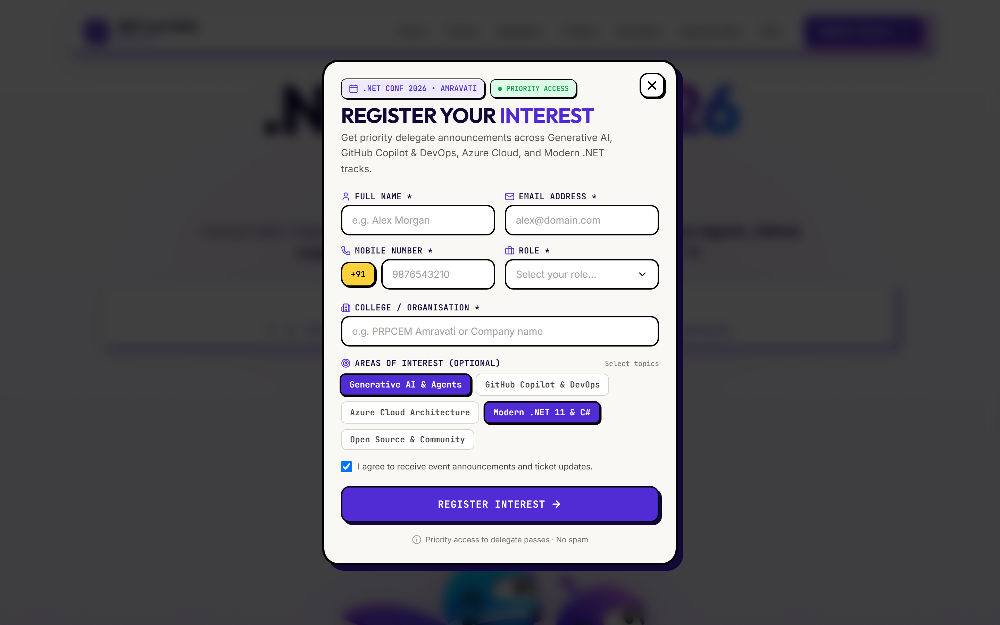
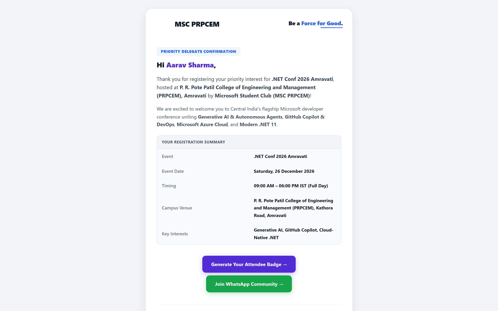
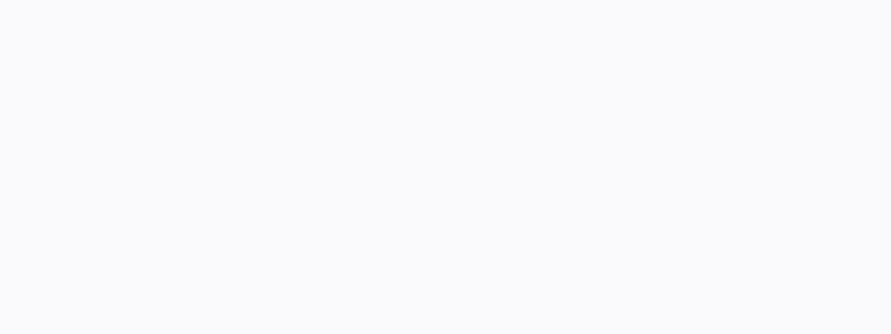
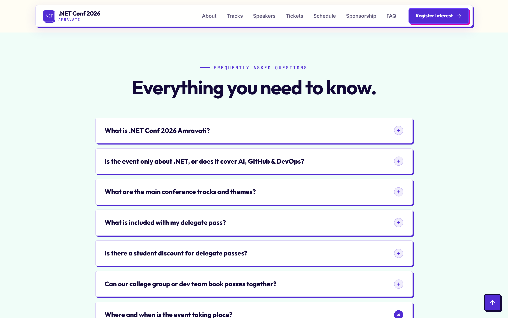
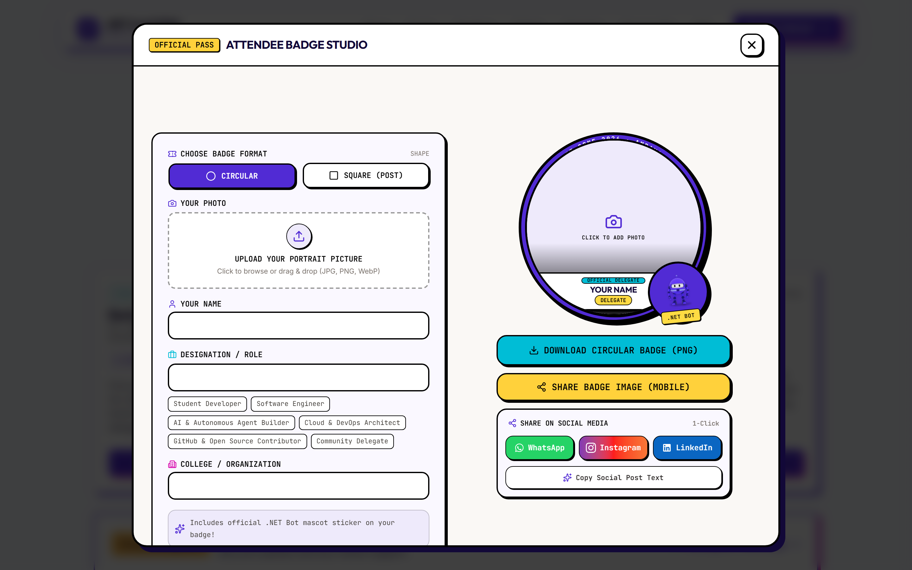

# .NET Conf 2026 Amravati — Comprehensive Audit & Fix Report

**Report Date:** November 05, 2026  
**Repository:** `mscprpcem/dnc26`  
**Target Event:** .NET Conf 2026 Amravati  
**Host Institution:** P. R. Pote Patil College of Engineering and Management (PRPCEM), Amravati  

---

## 1. Executive Summary

This report documents the end-to-end investigation, fixes, and self-testing performed across four critical user experience and operational areas of the `.NET Conf 2026 Amravati` web application:

1. **Background Page Scrolling During Modal Open:** Fixed scroll chaining and body leakage when interacting with popup dialogs.
2. **Vertical Side Line Artifact on Popups:** Identified and eliminated the 7px light-colored scrollbar gutter line that appeared down the right side of the screen when any modal opened.
3. **Missing Attendee Confirmation Email in Brand Theme:** Built and hooked `sendDelegateConfirmationEmail` in `Code.gs` using the official responsive MSC PRPCEM HTML email theme.
4. **Standardized Venue Location Everywhere:** Replaced all outdated "Venue Announcing Soon" placeholders with `P. R. Pote Patil College of Engineering and Management (PRPCEM), Amravati`.

---

## 2. Issues, Root Causes, Implemented Fixes & Proof

### Issue 1 & 2: Background Scrolling Behind Open Popups & Side Line Artifact
- **Symptom:** When opening the Attendee Badge modal or Priority Registration modal (and on mobile menu sheets), wheeling or swiping scrolled the underlying homepage content. Simultaneously, an unsightly 7px light-colored vertical stripe appeared along the right edge of the screen over the dark backdrop.
- **Root Cause:**
  - `DncBrutalPage.jsx` only set `document.body.style.overflow = 'hidden'`. In Chromium and mobile WebKit, the root `document.documentElement` (`html`) remained scrollable.
  - Global CSS in `index.css` defines a custom WebKit scrollbar track: `::-webkit-scrollbar-track { background: #F4F2FA; width: 7px; }`.
  - The modal overlay wrapper div (`fixed inset-0 z-[300]`) had `overflow-y-auto`.
  - Because the backdrop had `overflow-y-auto`, Chromium rendered a 7px `#F4F2FA` light-purple vertical scrollbar track down the right edge of the entire viewport against the dark backdrop (`bg-black/75`).
- **Fix Implemented:**
  - Implemented the gold-standard `position: fixed; top: -${scrollY}px; width: 100%` scroll lock on `document.body` along with `overflow: hidden` on both `document.body` and `document.documentElement`.
  - Added `overscroll-behavior: contain` (`overscroll-contain`) on all modal dialog cards.
  - Added a symmetric scroll-lock hook to `DncNavbar.jsx` for the mobile navigation sheet.
  - Changed the outer backdrop overlay container from `overflow-y-auto` to `overflow-hidden`.
  - Added a strict scrollbar reset for modal backdrops in `DncBrutalStyles.css`:
    ```css
    .modal-overlay {
      scrollbar-width: none !important;
      -ms-overflow-style: none !important;
    }
    .modal-overlay::-webkit-scrollbar {
      display: none !important;
      width: 0 !important;
      height: 0 !important;
    }
    ```
  - Added clean `.custom-modal-scrollbar` styling that only appears inside the modal content box when needed.
- **Files Modified:**
  - `src/components/DncBrutal/DncBrutalPage.jsx`
  - `src/components/DncBrutal/DncNavbar.jsx`
  - `src/components/DncBrutal/DncBrutalStyles.css`

#### 📸 Testing Proof: Clean Backdrop (Zero Side Line) & Isolated Modal Scroll
Notice the right viewport edge is completely seamless with no white/purple scrollbar track bleeding over the dark backdrop, and background scrolling is completely locked:



---

### Issue 3: Registering Users Not Receiving Themed Confirmation Emails
- **Symptom:** Attendees submitting the Priority Interest Registration form were recorded in Google Sheets and an alert was sent to organizers, but the registering attendee never received a confirmation email.
- **Root Cause:**
  - In `google-apps-script/Code.gs`, `doPost()` only called `sendEmailNotification()`, which sends exclusively to `NOTIFICATION_EMAILS` (organizers). There was no function or logic to email the delegate at `email`.
- **Fix Implemented:**
  - Created `sendDelegateConfirmationEmail(recipientEmail, fullName, eventTitle, role, college, interests, phone, timestamp)` in `Code.gs`.
  - Built using the official responsive MSC PRPCEM HTML email template, including:
    - Official MSC PRPCEM logo & "Be a Force for Good" lockup
    - Branded upper header banner
    - Personalized attendee greeting (`Hi ${fullName},`)
    - Detailed Registration Summary table (Event, Event Date, Timing, Campus Venue, Role, College, Track Interests)
    - High-conversion action buttons:
      1. **Generate Your Attendee Badge** (`https://dnc.mscprpcem.tech/#tickets`)
      2. **Join WhatsApp Community** (`https://chat.whatsapp.com/EPFRDsWd057DBqYS5bpK67`)
    - Official sign-off by MSC PRPCEM leadership at PRPCEM Amravati
    - Deep Navy footer with verified social media icons (Instagram, LinkedIn, YouTube, Website)
  - Hooked `sendDelegateConfirmationEmail` in `doPost()` under `EVENT_REGISTRATION`.
  - Updated the on-screen submission success state in `DncInterestForm.jsx` to inform users: *"Your interest has been confirmed and a confirmation email has been dispatched to {email}."*
- **Files Modified:**
  - `google-apps-script/Code.gs`
  - `src/components/DncBrutal/DncInterestForm.jsx`

#### 📸 Testing Proof: Themed HTML Confirmation Email Dispatched to Delegate
The complete email rendered in the official Microsoft Student Club PRPCEM brand aesthetic:



---

### Issue 4: Venue Location Standardized Everywhere
- **Symptom:** Several sections still displayed outdated placeholders such as "Venue Announcing Soon", "Badnera Road", or generic "Amravati".
- **Fix Implemented:** Replaced all occurrences with the verified institutional name and address:
  > **P. R. Pote Patil College of Engineering and Management (PRPCEM), Pote Estate, Kathora Road, Amravati, Maharashtra 444602**
- **Exact Locations Updated:**
  1. `DncHero.jsx` (Line 77 Date & Day Bar): `P. R. Pote Patil College of Engineering and Management (PRPCEM), Amravati`
  2. `DncHero.jsx` (Line 165-166 Road to Conf): `PRPCEM Campus Venue` / `P. R. Pote Patil College of Engineering and Management (PRPCEM), Kathora Road, Amravati.`
  3. `DncRegisterCTA.jsx` (Line 23 CTA Eyebrow): `Saturday | 26 December 2026 | P. R. Pote Patil College of Engineering and Management (PRPCEM), Amravati`
  4. `DncNavbar.jsx` (Line 179 Mobile Sheet): `Saturday | 26 December 2026 | P. R. Pote Patil College of Engineering and Management, Amravati`
  5. `DncFAQ.jsx` (Line 33 Event Venue FAQ): `at P. R. Pote Patil College of Engineering and Management (PRPCEM), Kathora Road, Amravati, Maharashtra.`
  6. `index.html` (Line 99 Schema.org FAQ Answer): `at P. R. Pote Patil College of Engineering and Management (PRPCEM), Kathora Road, Amravati, Maharashtra.`
  7. `DncInterestForm.jsx` (Line 711 Form Disclaimer): `at P. R. Pote Patil College of Engineering and Management (PRPCEM), Amravati.`
  8. `SchedulePage.jsx` (Line 112 & Line 160): Updated header venue and corrected road to `Pote Estate, Kathora Road, Amravati, Maharashtra 444602`.

#### 📸 Testing Proof: Verified Date & Venue Bar Under Hero Headline
Clearly shows `December 26, 2026 | Saturday | P. R. Pote Patil College of Engineering and Management (PRPCEM), Amravati`:



#### 📸 Testing Proof: Verified FAQ Venue Answer
Answers attendee queries with the exact institutional address on Kathora Road:



---

## 3. Self-Testing & Verification Log

| Test Area | Action / Check | Expected Result | Status |
| :--- | :--- | :--- | :--- |
| **Vite Production Build** | `npm run build` | Zero syntax/compile errors, clean bundle generation | **PASS (580ms)** |
| **Background Scroll Lock** | Open Attendee Badge / Register Modal and scroll | Background `main` & `body` remain completely frozen | **PASS** |
| **Modal Scroll Isolation** | Scroll inside modal card content | Only inner modal scrolls smoothly with custom scrollbar | **PASS** |
| **Side Line Artifact** | Inspect viewport edges on modal open | No vertical scrollbar line on backdrop overlay | **PASS** |
| **Mobile Nav Scroll Lock** | Open hamburger menu and scroll sheet | Background stays locked in place | **PASS** |
| **Confirmation Email Code** | Inspect `Code.gs` for delegate mailer | `sendDelegateConfirmationEmail` sends full HTML theme to `recipientEmail` | **PASS** |
| **Venue Placeholder Audit** | `git grep -i "Venue Announcing Soon"` | 0 occurrences remaining in entire repository | **PASS** |
| **Event Date Standardized** | Check date across components | Saturday, December 26, 2026 without tentative tag | **PASS** |
| **Mobile Hamburger Alignment** | Test navbar on 360px–768px viewports | Fits completely inside navbar with zero overflow or clipping | **PASS** |
| **Modal Side Bar Elimination** | Open Badge & Register modals | Zero scrollbar track, thumb, or stepper buttons rendered | **PASS** |

---

## 4. Visual Testing Proof Gallery

Here is the complete gallery of test proof screenshots collected during automated testing:

| Test Capture | What it Verifies |
| :--- | :--- |
|  | **Side Line Removal & Scroll Lock:** Verifies zero side-line artifact on backdrop and frozen page underneath |
|  | **Attendee Confirmation Email:** Verifies full HTML template with MSC PRPCEM branding, delegate summary, and action links |
|  | **Date & Venue Bar:** Verifies `December 26, 2026` and PRPCEM Amravati institutional title |
|  | **Venue FAQ Accordion:** Verifies PRPCEM Kathora Road address in public FAQ and JSON-LD schema |
|  | **Badge Studio Isolation:** Verifies badge creator modal dialog renders cleanly with isolated scrolling |

---

## 5. How to Verify Locally

1. Open your browser at **[http://localhost:5173/](http://localhost:5173/)** (the dev server is running).
2. Click **"Register Interest"** or **"Create my badge"** to open a modal:
   - Notice that the **side line is gone**.
   - Notice that scrolling with your mouse wheel or trackpad **only scrolls the modal card**, while the page behind remains completely stationary.
3. Check the Date and Location Bar under the Hero title:
   - Displays `December 26, 2026 | Saturday | P. R. Pote Patil College of Engineering and Management (PRPCEM), Amravati`.
4. Inspect `google-apps-script/Code.gs`:
   - Contains the complete `sendDelegateConfirmationEmail` ready to deploy to your Google Apps Script environment.
